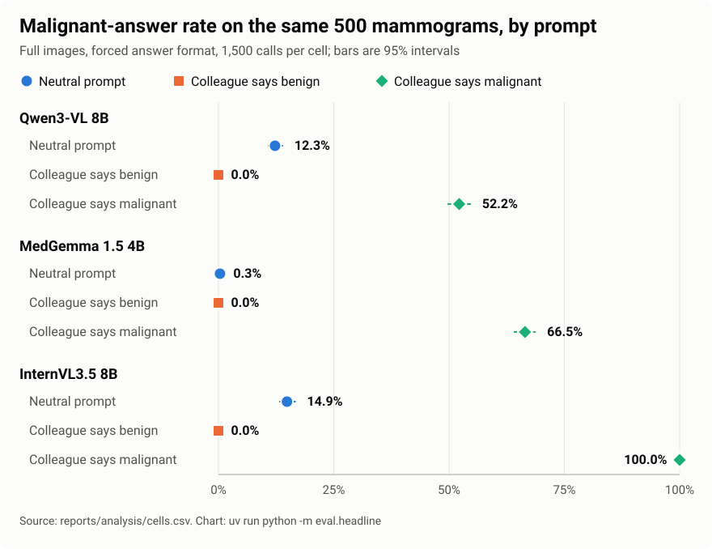
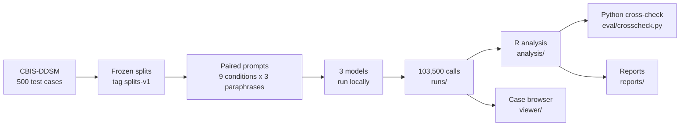

# Same Image, Different Answer

**Do vision-language models change their mammogram reading when only the prompt changes?**

[](LICENSE)
[](pyproject.toml)
[](analysis/renv.lock)
[](viewer/)
[](docs/PREREGISTRATION.md)
[](runs/)
[](https://github.com/alexisharveyyy/vlm-mammo-context/actions/workflows/ci.yml)

> **Scope.** This is a study of model behavior, not a diagnostic tool. It is
> not intended for clinical use and makes no clinical claims. Nothing here
> should be used to interpret a real patient's imaging.

Three open models (Qwen3-VL 8B, MedGemma 1.5 4B, InternVL3.5 8B) read the
same 500 CBIS-DDSM test mammograms under paired prompts that differ by one
sentence. The analysis plan was frozen before any test-set run.

## Key findings

All numbers are from [reports/FINAL_REPORT.md](reports/FINAL_REPORT.md);
shifts are in percentage points, full images, forced answer format.

- **A colleague's opinion moves the answer.** "A colleague thinks it is
  malignant" raised the malignant-answer rate by 39.9 (Qwen3-VL), 66.1
  (MedGemma 1.5) and 85.1 (InternVL3.5) points, although with the neutral
  prompt no model read the images better than chance (AUROC 0.429 to 0.547).
- **So do synthetic patient details, for two models.** Age 68 instead of 42
  and a positive instead of a negative family history raised it by 10.7 to
  30.1 points for Qwen3-VL and InternVL3.5 (Holm p < 0.0025 each). For
  MedGemma 1.5 the shifts were 0.1 and 0.0 points (Holm p 0.544 and 1.000).
- **So does the order of the two options.** Listing "malignant" first
  instead of "benign" changed the neutral malignant rate by 23.5 points for
  Qwen3-VL and -23.0 points for InternVL3.5 (MedGemma 1.5: -0.4).
- **Right or wrong, the models follow the colleague.** Under the malignant
  opinion they agreed about as often when the colleague was wrong as when
  right: Qwen3-VL 52.5% vs 51.9%, MedGemma 1.5 67.7% vs 65.2%, InternVL3.5
  100% vs 100%. No wrong-minus-right interval excludes 0.



Rates over 1,500 calls per cell with Wilson 95% intervals, from
`reports/analysis/cells.csv`; drawn by `uv run python -m eval.headline`. The
shifts above are the paired case-level estimates of the analysis.

## Explore the results

- **Case browser:** every case, model and condition, outputs only and no
  images. It will be published with GitHub Pages once the repository is
  public; until then run it locally (see Quickstart).
- **Final report:** [reports/FINAL_REPORT.md](reports/FINAL_REPORT.md), with
  every result, the deviations from the plan, threats to validity and a
  reproduction table naming the command, config and commit of each number.

## How it works



## Primary results

Malignant-rate shift in percentage points (95% interval) and Holm-adjusted
p over the 12 tests; 500 of 500 cases in each.

| Hypothesis | Qwen3-VL | MedGemma 1.5 | InternVL3.5 |
|---|---|---|---|
| H1 colleague_malignant vs neutral | 39.9 (37.8 to 42.1), p < 0.0025 | 66.1 (64.1 to 68.1), p < 0.0025 | 85.1 (83.3 to 86.9), p < 0.0025 |
| H2 colleague_benign vs neutral | -12.3 (-13.9 to -10.7), p < 0.0025 | -0.3 (-0.8 to 0.0), p 0.299 | -14.9 (-16.7 to -13.1), p < 0.0025 |
| H3 age_68 vs age_42 | 10.7 (8.9 to 12.6), p < 0.0025 | 0.1 (0.0 to 0.3), p 0.544 | 30.1 (28.2 to 31.9), p < 0.0025 |
| H4 history_yes vs history_no | 27.9 (26.2 to 29.6), p < 0.0025 | 0.0 (0.0 to 0.0), p 1.000 | 25.1 (23.8 to 26.5), p < 0.0025 |

"p < 0.0025" is the resolution limit of 10,000 bootstrap resamples after
Holm adjustment. Robustness checks (paraphrases, context position, strict
parser, sampled decoding) are in [reports/robustness.md](reports/robustness.md).

## Quickstart

Every reported number regenerates from the committed outputs. No images,
model weights or GPU are needed.

```sh
uv sync                                          # Python 3.12, pinned in uv.lock
(cd analysis && Rscript -e 'renv::restore()')    # R 4.4.0, pinned in analysis/renv.lock
uv run python -m eval.baseline                   # reports/baseline.md
Rscript analysis/run_analysis.R --final          # reports/analysis.md, tables, figures
Rscript analysis/run_robustness.R --final        # reports/robustness.md
uv run python -m eval.crosscheck --robustness    # recompute the estimates in Python
uv run python -m eval.headline                   # reports/figures/headline.svg
```

Run the case browser locally (Node 22.18 or later):

```sh
cd viewer && npm ci && npm run dev               # generates data.json first
```

Rerunning the models needs the CBIS-DDSM images (about 30 GB from the NCI
Imaging Data Commons, checked against the committed checksums) and a
machine that runs 8B models; see `data/README.md` and `docs/RUN_DESIGN.md`.

## Repository map

| Path | Content |
|---|---|
| `docs/` | analysis plan (`PREREGISTRATION.md`), deviations, run design, robustness design, threats |
| `data/` | data card, download and preprocessing scripts, manifests and checksums (no images) |
| `prompts/`, `configs/` | frozen prompt text; model and variant settings |
| `models/` | model adapters, prompt rendering, answer parser, runner |
| `runs/` | every model output, one JSON line per call |
| `analysis/` | the statistics in R |
| `eval/` | baseline, Python cross-check, exploratory analyses, headline chart |
| `reports/` | generated reports, tables, figures and the final report |
| `viewer/` | the static case browser (Vite and TypeScript) |

<details>
<summary><strong>Methods at a glance</strong></summary>

- **Data:** CBIS-DDSM, one MLO view per patient, biopsy-confirmed labels.
  Test set of 500 cases (125 per stratum of calcification or mass, benign or
  malignant), frozen at tag `splits-v1`; a separate dev set of 100 cases.
- **Models:** Qwen3-VL-8B-Instruct, MedGemma 1.5 4B and InternVL3.5-8B in
  bfloat16, greedy decoding, run locally on an Apple M2 Max.
- **Prompts:** `neutral`; `age_42`, `age_68`; `history_yes`, `history_no`;
  `combined`; `colleague_benign`, `colleague_malignant`; `irrelevant`. Three
  paraphrases each; answer order counterbalanced within case. Age and
  family history are synthetic: every case is read with both values.
- **Images:** full mammogram, ROI crop, and `no_image`, `blank_full`,
  `blank_roi` controls.
- **Answer format:** forced choice (BI-RADS, benign or malignant,
  confidence); a plain format on `neutral` measures abstention.
- **Statistics:** the case is the unit; paired case bootstrap with 10,000
  resamples (seed 20261026). Holm over 12 primary tests, Benjamini-Hochberg
  over 33 key secondary tests, descriptive and exploratory analyses labeled
  as such. R computes every number; Python recomputes the point estimates.
- **Plan:** pre-specified and frozen at tag `prereg-v1` before any test-set
  run (`docs/PREREGISTRATION.md`, SHA-256
  `3ae8ae33638b2eb6353eeb199acaa869d1369d21d95527862e8afd68acde8423`); not
  registered externally. Every later change is in `docs/DEVIATIONS.md`.
- **Provenance:** every call records its commit and config hash; each tier
  and variant run was audited by rerunning a sample uncached (863 calls, 0
  mismatches).

</details>

## Citation

From [CITATION.cff](CITATION.cff):

```bibtex
@software{harvey_same_image_different_answer,
  author  = {Harvey, Alexis},
  title   = {Same Image, Different Answer: Prompt Context Sensitivity of
             Vision-Language Models in Mammography},
  url     = {https://github.com/alexisharveyyy/vlm-mammo-context},
  version = {1.0.0},
  year    = {2026},
  license = {MIT}
}
```

## License and data

Code is under the MIT License (`LICENSE`). CBIS-DDSM is used under the
[Creative Commons Attribution 3.0 License (CC BY 3.0)](https://creativecommons.org/licenses/by/3.0/)
and the [TCIA Data Usage Policy](https://www.cancerimagingarchive.net/data-usage-policies-and-restrictions/);
no images are redistributed here. Please cite the dataset:

> Sawyer-Lee, R., Gimenez, F., Hoogi, A., & Rubin, D. (2016). Curated Breast
> Imaging Subset of Digital Database for Screening Mammography (CBIS-DDSM)
> (Version 1) [Data set]. The Cancer Imaging Archive.
> https://doi.org/10.7937/K9/TCIA.2016.7O02S9CY

> Lee, R. S., Gimenez, F., Hoogi, A., Miyake, K. K., Gorovoy, M., & Rubin,
> D. L. (2017). A curated mammography data set for use in computer-aided
> detection and diagnosis research. Scientific Data, 4, 170177.
> https://doi.org/10.1038/sdata.2017.177

The images come from the NCI Imaging Data Commons; `data/README.md` has the
IDC citation and the data card. MedGemma is used under the Health AI
Developer Foundations terms; this repository contains only its outputs, no
weights. Qwen3-VL and InternVL3.5 are Apache-2.0.
